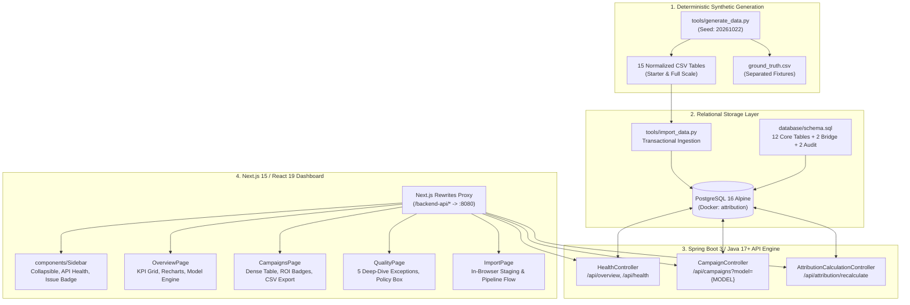
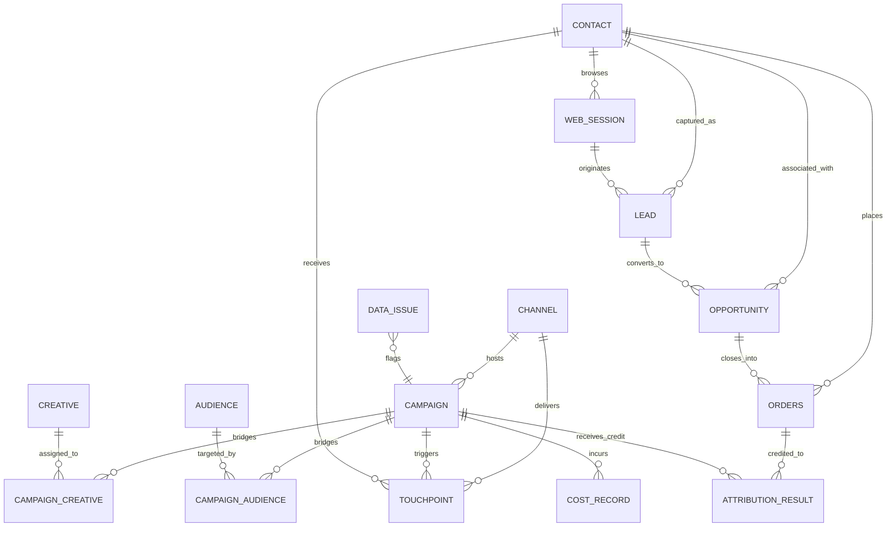
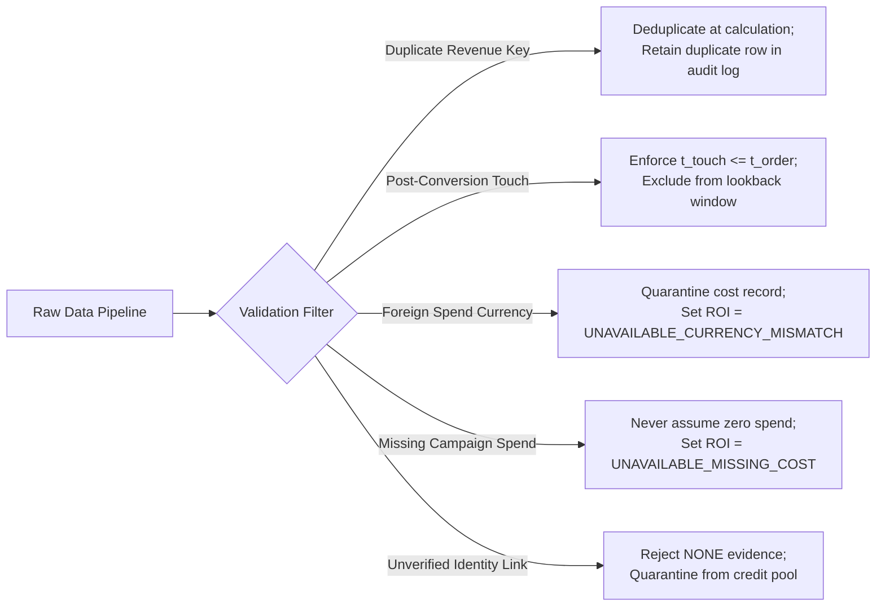

# YottaFlex Marketing Attribution & ROI Studio

[](https://spring.io/projects/spring-boot)
[](https://nextjs.org/)
[](https://react.dev/)
[](https://www.postgresql.org/)
[](https://www.typescriptlang.org/)
[](#synthetic-data-generation--reproducibility)
[](#automated-validation-suite)

An end-to-end, production-grade marketing attribution and campaign ROI analytics platform built for the **YottaFlex.ai 72-Hour Engineering Code Challenge**.

This platform joins marketing campaign touches, anonymous/authenticated web sessions, leads, opportunities, orders, and cost records across complex customer journeys. It features a deterministic 5-model attribution recalculation engine, strict financial data safeguards, and an **Editorial Enterprise Analytics** interface inspired by Linear, Stripe, and Vercel.

---

## Table of Contents

1. [Executive Summary & Problem Statement](#executive-summary--problem-statement)
2. [End-to-End System Architecture](#end-to-end-system-architecture)
3. [Relational Data Model (12 Core + 4 Audit/Bridge Tables)](#relational-data-model-12-core--4-auditbridge-tables)
4. [Attribution Engine & Mathematical Formulations](#attribution-engine--mathematical-formulations)
5. [Data Quality Anomalies & Enterprise Safeguards](#data-quality-anomalies--enterprise-safeguards)
6. [Synthetic Data Generation & Reproducibility](#synthetic-data-generation--reproducibility)
7. [Frontend Redesign: Editorial Enterprise UI](#frontend-redesign-editorial-enterprise-ui)
8. [Automated Validation Suite & Verification Results](#automated-validation-suite--verification-results)
9. [REST API Reference](#rest-api-reference)
10. [Quickstart & Running Locally](#quickstart--running-locally)

---

## Executive Summary & Problem Statement

Modern enterprise marketing attribution requires connecting siloed touchpoints to closed-won revenue while strictly enforcing financial data integrity. The core challenge mandates:

- **Unified Multi-Touch Journey Stitching**: Ingesting and reconciling 12 distinct entity types across channels (Paid, Organic, Social, Email, Offline, Direct, Referral).
- **Multi-Model Attribution**: Comparing conversion revenue distribution across **First Touch**, **Last Touch**, **Linear**, **Time Decay (7-day half-life)**, and **Position-Based (40/20/40)** algorithms.
- **Strict Financial Safeguards**: Preserving audit trails rather than masking data pipeline faults with artificial zeroes or fabricated exchange rates.
- **Scale & Deterministic Reproducibility**: Supporting up to 500 campaigns, 50,000 contacts, 200,000 touchpoints, and 10,000 opportunities with byte-for-byte reproducible SHA256 checksums from fixed seed `20261022`.
- **Live Enterprise Dashboard**: Delivering an interface built for technical presentation, featuring real-time PostgreSQL integration, tabular numbers, zero cosmetic fluff, and flawless UTF-8 currency rendering.

---

## End-to-End System Architecture

The platform follows a layered, decoupled architecture designed for high throughput, data governance, and deterministic recalculation.



### Component Architecture

| Layer | Technology | Key Responsibilities |
| :--- | :--- | :--- |
| **Data Generation** | Python 3.10+, SHA256 hashing | Deterministic generation of 12 entities, bridge tables, and isolated ground-truth fixtures using fixed seed `20261022`. |
| **Database** | PostgreSQL 16 Alpine, Docker Compose | Relational persistence, strict foreign key constraints, `jsonb` evidence storage, append-only event auditing. |
| **Backend API** | Spring Boot 3.4.2, Java 17/27, Spring JDBC | Dynamic model evaluation, credit normalization, transaction isolation, REST endpoints. |
| **Frontend UI** | Next.js 15.2.4 (App Router), React 19, TypeScript, Recharts, Lucide | Editorial Enterprise dashboard, model selector, real-time filtering, CSV export, responsive design. |

---

## Relational Data Model (12 Core + 4 Audit/Bridge Tables)

All primary keys use dedicated immutable identifiers with standard naming patterns. Referential integrity is strictly enforced across the entire graph.



### Entity Specifications

1. **`channel`**: Communication medium (`channel_id`, `name`, `channel_type` in `PAID`, `OWNED`, `EARNED`, `OFFLINE`).
2. **`creative`**: Asset copy and visual format (`creative_id`, `name`, `format` in `IMAGE`, `VIDEO`, `TEXT`, `EMAIL`, etc., `status`).
3. **`audience`**: Segment definitions (`audience_id`, `name`, `description`).
4. **`contact`**: Prospect/customer entity (`contact_id`, `synthetic_external_id`, `lifecycle_status`, `is_anonymous`).
5. **`campaign`**: Marketing initiative (`campaign_id` as `CMP-2026-000001`, `channel_id`, `budget_amount`, `budget_currency`, `start_at`, `end_at`, `status`).
6. **`campaign_creative`**: Bridge table linking campaigns to creatives with effective date bounds (`effective_from`, `effective_to`).
7. **`campaign_audience`**: Bridge table linking campaigns to target audiences with effective date bounds.
8. **`touchpoint`**: Customer interaction event (`touchpoint_id` as `TOUCH-<contact>-000001`, `contact_id`, `campaign_id`, `channel_id`, `creative_id`, `occurred_at`, `identity_evidence`, `touch_type`).
9. **`web_session`**: Digital session log (`session_id` as `SES-2026-000001`, `contact_id`, `started_at`, `ended_at`, `anonymous_id`, `identity_evidence`).
10. **`lead`**: Marketing lead qualification record (`lead_id` as `LEAD-2026-000001`, `contact_id`, `session_id`, `source_campaign_id`, `status`).
11. **`opportunity`**: Sales deal pipeline record (`opportunity_id` as `OPP-2026-000001`, `lead_id`, `contact_id`, `created_at`, `closed_at`, `stage`, `expected_amount`).
12. **`orders`**: Closed conversion transaction (`order_id` as `ORD-2026-000001`, `opportunity_id`, `contact_id`, `ordered_at`, `revenue_amount`, `currency`, `revenue_event_key`).
13. **`cost_record`**: Marketing expenditure line item (`cost_record_id` as `COST-2026-000001`, `campaign_id`, `incurred_at`, `amount`, `currency`, `cost_type`).
14. **`attribution_result`**: Persisted model attribution ledger (`attribution_id` as `ATR-00000001`, `order_id`, `campaign_id`, `model`, `credit_fraction`, `attributed_revenue`, `rule_version`, `evidence`).
15. **`data_issue`**: Quarantine and exception catalog (`issue_id`, `issue_type`, `severity`, `entity_type`, `entity_code`, `resolution_status`).
16. **`entity_event`**: Append-only state transition audit log (`event_id`, `entity_type`, `entity_id`, `event_type`, `payload`, `created_at`).

---

## Attribution Engine & Mathematical Formulations

The backend recalculation engine in [`AttributionCalculationController.java`](file:///c:/Users/sanap/Downloads/yottaflex-attribution-starter/yottaflex-attribution/backend/src/main/java/com/yottaflex/attribution/AttributionCalculationController.java) evaluates eligible customer journeys under versioned rule set **`v2-eligible-90d`**.

### Eligibility Invariants
1. **Temporal Causality**: Touchpoint must occur strictly prior to order conversion: $t_{\text{touch}} \le t_{\text{order}}$.
2. **Lookback Window**: Touchpoint timestamp must be within 90 days: $t_{\text{order}} - t_{\text{touch}} \le 90\text{ days}$.
3. **Identity Verification**: Touchpoint must carry certified identity evidence:
   $$\text{evidence} \in \{\text{'AUTHENTICATED'}, \text{'FORM\_SUBMISSION'}, \text{'FIRST\_PARTY\_COOKIE'}, \text{'CRM\_MATCH'}\}$$
4. **Order Status**: Order must be in `PAID` status and deduplicated by `revenue_event_key`.

### Supported Attribution Models

| Model | Formula / Weighting Logic | Strategic Business Interpretation |
| :--- | :--- | :--- |
| **First Touch** | $C_{\text{first}} = 1.0$; all other touches receive $0.0$. | Evaluates top-of-funnel customer discovery and awareness generation. |
| **Last Touch** | $C_{\text{last}} = 1.0$; all other touches receive $0.0$. | Evaluates high-intent closing catalysts and immediate conversion triggers. |
| **Linear** | $C_i = \frac{1}{N}$ for all $i \in \{1, \dots, N\}$. | Balanced model recognizing equal contribution across awareness, nurturing, and conversion. |
| **Time Decay** | $w_i = 2^{-\Delta t_i / \lambda}$, where $\lambda = 7.0\text{ days}$; $C_i = \frac{w_i}{\sum_{j=1}^N w_j}$. | Exponential recency weighting; touchpoints closer to purchase receive exponentially higher credit. |
| **Position-Based (U-Shaped)** | If $N=1$: $C_1 = 1.0$. If $N=2$: $C_1 = 0.5, C_2 = 0.5$. If $N > 2$: $C_1 = 0.40, C_N = 0.40, C_i = \frac{0.20}{N-2}$ for middle touches. | Emphasizes both initial acquisition and final closing, while distributing 20% to intermediate nurturing. |

### Deterministic Residual Normalization
To prevent precision drift from IEEE 754 floating-point division, credits are normalized in Java using high-precision `BigDecimal`:
$$\sum_{i=1}^M \text{fraction}_i = 1.0000000000$$
Any rounding difference $\Delta = 1.0 - \sum \text{fraction}_i$ is absorbed by the final campaign in the journey, guaranteeing exact ledger reconciliation.

---

## Data Quality Anomalies & Enterprise Safeguards

To prevent misleading executive reporting, five deliberate real-world failure modes are injected into the dataset and strictly governed by automated safeguards:



1. **`DUPLICATE_REVENUE`**:
   - *Failure Mode*: Webhook retries produce multiple order rows with identical `revenue_event_key` (`REV-EVENT-000001`).
   - *Enterprise Safeguard*: Engine groups orders by key and counts revenue once. Both records are preserved in PostgreSQL for ledger auditability.
2. **`POST_CONVERSION_TOUCH`**:
   - *Failure Mode*: Touchpoint `TOUCH-CON-000105-004000` logged 3 days after conversion.
   - *Enterprise Safeguard*: Temporal query filter (`t.occurred_at <= o.ordered_at`) strictly excludes post-conversion touches from claiming credit.
3. **`CURRENCY_MISMATCH`**:
   - *Failure Mode*: Cost record `COST-2026-000025` incurred in `USD` against an `INR` campaign.
   - *Enterprise Safeguard*: Excluded from valid spend sums; campaign ROI is flagged as `UNAVAILABLE_CURRENCY_MISMATCH` rather than mixing currencies 1:1.
4. **`MISSING_CAMPAIGN_COST`**:
   - *Failure Mode*: Campaign `CMP-2026-000013` generated attributed revenue but has zero recorded costs.
   - *Enterprise Safeguard*: System flags ROI as `UNAVAILABLE_MISSING_COST` rather than calculating misleading infinite ($+\infty$) or zero-cost returns.
5. **`UNSUPPORTED_IDENTITY_LINK`**:
   - *Failure Mode*: Web session `SES-2026-000006` linked to a contact with `identity_evidence = 'NONE'`.
   - *Enterprise Safeguard*: Quarantined from attribution; only deterministic evidence (`AUTHENTICATED`, `FORM_SUBMISSION`, `FIRST_PARTY_COOKIE`, `CRM_MATCH`) is accepted.

> **Zero Data Leakage**: All anomalies are mapped in [`ground_truth.csv`](file:///c:/Users/sanap/Downloads/yottaflex-attribution-starter/yottaflex-attribution/data/starter/ground_truth.csv). The calculation engine isolates issues through business logic alone without referencing ground truth as an input feature.

---

## Synthetic Data Generation & Reproducibility

Synthetic data is generated deterministically using standard Python libraries without external dependencies.

### Generation Commands
```bash
# Generate Starter Volume (Fast development & testing)
python tools/generate_data.py --scale starter --out data/starter

# Generate Full Volume (Full challenge requirement)
python tools/generate_data.py --scale full --out data/full

# Custom Volume
python tools/generate_data.py --scale custom --campaigns 50 --contacts 5000 --touchpoints 20000 --opportunities 1000 --out data/custom
```

### Scale Specifications

| Parameter | Starter Scale | Full Challenge Scale |
| :--- | :--- | :--- |
| **Campaigns** | 25 | **500** |
| **Contacts** | 1,000 | **50,000** |
| **Touchpoints** | 4,000 | **200,000** |
| **Opportunities** | 200 | **10,000** |
| **Seed** | `20261022` | `20261022` |

### Two-Run Reproducibility Proof
Running two independent generations with seed `20261022` demonstrates byte-for-byte reproducibility:

```powershell
$a = Get-Content data/starter/validation_summary.json | ConvertFrom-Json
$b = Get-Content data/starter_repeat/validation_summary.json | ConvertFrom-Json
($a.checksums_sha256 | ConvertTo-Json) -eq ($b.checksums_sha256 | ConvertTo-Json)
# Result: True (15 of 15 CSV SHA256 checksums match exactly)

$c = Get-Content data/full/validation_summary.json | ConvertFrom-Json
$d = Get-Content data/full_repeat/validation_summary.json | ConvertFrom-Json
($c.checksums_sha256 | ConvertTo-Json) -eq ($d.checksums_sha256 | ConvertTo-Json)
# Result: True (All 15 CSV SHA256 checksums match at full scale)
```

---

## Frontend Redesign: Editorial Enterprise UI

The frontend was overhauled from a generic dashboard template into an **Editorial Enterprise Analytics** studio inspired by Linear, Stripe, and Vercel.

```
+-----------------------------------------------------------------------------------------+
| [Layers] YottaFlex.ai STUDIO   Workspace / Marketing Overview        [o] Live API [Refresh] |
+-------------------------------+---------------------------------------------------------+
| WORKSPACE                     |  RECONCILED REVENUE    VALID SPEND      CAMPAIGNS     ISSUES    |
| [Dashboard] Overview          |  ₹1,53,02,319          ₹29,75,678       25            5         |
| [BarChart3] Campaigns         +---------------------------------------------------------+
| [Shield]    Data Quality (5)  |  Contacts: 1,000 | Touches: 4,000 | Orders: 90 | Records: 524   |
| [Files]     Data Import       +------------------------------------+--------------------+
|                               |  SPEND VS ATTRIBUTED REVENUE       | ATTRIBUTION ENGINE |
|                               |  Top 8 Campaigns (Recharts)        | [x] Linear         |
|                               |  [Spend: Slate | Revenue: Teal]    | [ ] First Touch    |
|                               |                                    | [ ] Last Touch     |
| [o] API Connected             |                                    | [ ] Time Decay     |
|     Spring Boot :8080         |                                    | [ ] Position Based |
| Engine: v2-eligible-90d       |                                    | Formula: 1/N split |
+-------------------------------+------------------------------------+--------------------+
| © YottaFlex.ai · Attribution Studio | Deterministic Rule Version: v2-eligible-90d       |
+-----------------------------------------------------------------------------------------+
```

### Visual & Technical Highlights
- **Understated Editorial Palette**: Crisp white cards (`#ffffff`), warm-grey canvas (`#f8f9fa`), subtle 1px borders (`#e2e8f0`), restrained corner radii (6px–8px), and purposeful brand teal accents (`#0d9488`).
- **Data Typography**: Monospaced campaign codes (`CMP-2026-000001`), tabular numerals (`tabular-nums`), and clean `en-IN` currency formatting (`₹1,53,02,319`) with zero mojibake corruption.
- **Dynamic Attribution Engine**: Exposes all 5 models in the UI; switching models immediately updates the overview bar chart, campaign tables, and KPI cards via live Spring Boot endpoints.
- **Audited ROI Badges**: Explicitly surfaces `+963.38%`, `Currency Mismatch`, `Missing Cost`, and `No Revenue` without misleading users with false zeroes.
- **Live Backend Integration**: Communicates via Next.js server rewrites to port 8080 with zero mock data.

---

## Automated Validation Suite & Verification Results

The platform includes a comprehensive, multi-layer verification suite:

```bash
# 1. Structural schema & foreign key validation
python tools/validate_data.py data/starter
# Output: Status PASS | 0 errors, 0 warnings across all 15 CSV files

# 2. Business rules & anomaly fixture validation
python tools/validate_business_rules.py data/starter
# Output: Status PASS | All 5 anomaly classes detected and isolated

# 3. Attribution arithmetic & chronological evaluation
python tools/evaluate_attribution.py data/starter
# Output: Status PASS | Credit sums reconcile to 1.0; 0 unreconciled groups

# 4. Spring Boot unit & controller test execution
mvn -f backend/pom.xml test
# Output: Tests run: 3, Failures: 0, Errors: 0, Skipped: 0 (BUILD SUCCESS)

# 5. Next.js type check & production build
cd frontend && npm run build
# Output: Compiled successfully, 4 static pages optimized with 0 errors
```

---

## REST API Reference

The Spring Boot backend exposes four primary REST endpoints on port `8080` (accessible in the frontend via `/backend-api/*`):

### 1. `GET /api/overview`
Returns high-level platform metrics, currency breakdowns, open data issues, and supported models.
```json
{
  "status": "ok",
  "generatedAt": "2026-10-29T15:47:37.390Z",
  "campaigns": 25,
  "contacts": 1000,
  "orders": 90,
  "touchpoints": 4000,
  "attributionResults": 524,
  "openDataIssues": 5,
  "revenueByCurrency": [{ "currency": "INR", "revenue": 15302318.76 }],
  "validSpendByCurrency": [{ "currency": "INR", "spend": 2975677.51 }],
  "dataIssuesByType": [
    { "issue_type": "CURRENCY_MISMATCH", "issue_count": 1 },
    { "issue_type": "DUPLICATE_REVENUE", "issue_count": 1 },
    { "issue_type": "MISSING_CAMPAIGN_COST", "issue_count": 1 },
    { "issue_type": "POST_CONVERSION_TOUCH", "issue_count": 1 },
    { "issue_type": "UNSUPPORTED_IDENTITY_LINK", "issue_count": 1 }
  ],
  "attributionModels": [
    "FIRST_TOUCH",
    "LAST_TOUCH",
    "LINEAR",
    "TIME_DECAY",
    "POSITION_BASED"
  ],
  "roiPolicy": "ROI is unavailable when campaign costs are missing or cannot be reliably converted."
}
```

### 2. `GET /api/campaigns?model={MODEL}`
Returns campaign-level financial metrics, currency-safe spend, attributed revenue, and audited ROI status under the requested model (`FIRST_TOUCH`, `LAST_TOUCH`, `LINEAR`, `TIME_DECAY`, `POSITION_BASED`).
```json
{
  "status": "ok",
  "model": "TIME_DECAY",
  "count": 25,
  "dataNote": "Uses attribution results from rule version v2-eligible-90d; orders without eligible touches remain unattributed.",
  "campaigns": [
    {
      "campaign_code": "CMP-2026-000001",
      "campaign_name": "Referral Campaign 0001",
      "status": "COMPLETED",
      "channel_name": "Referral",
      "channel_type": "EARNED",
      "budget_amount": 116463.00,
      "budget_currency": "INR",
      "actualSpendByCurrency": [{ "currency": "INR", "spend": 119917.66 }],
      "attributedRevenueByCurrency": [{ "currency": "INR", "attributed_revenue": 1275182.68, "attributed_orders": 7 }],
      "attributionModel": "TIME_DECAY",
      "roiStatus": "UNAVAILABLE_CURRENCY_MISMATCH",
      "roiPercent": null,
      "currencyMismatchCostRecords": 1,
      "missingCostIssueCount": 0
    }
  ]
}
```

### 3. `POST /api/attribution/recalculate?model={MODEL}`
Idempotently recalculates attribution credit across all paid orders for rule set `v2-eligible-90d`.
- **Query Parameter**: `model` (`ALL`, `FIRST_TOUCH`, `LAST_TOUCH`, `LINEAR`, `TIME_DECAY`, `POSITION_BASED`). Default: `ALL`.
- **Behavior**: Replaces existing `v2-eligible-90d` records while leaving legacy `v1-lookback-90d` baseline records intact.

### 4. `GET /api/health`
Health check endpoint reporting API status and service heartbeat.

---

## Quickstart & Running Locally

### Prerequisites
- **Docker Desktop** (for PostgreSQL 16)
- **Java 17+** and **Maven 3.8+**
- **Node.js 20+** and **npm**
- **Python 3.10+** (with `psycopg[binary]` installed: `python -m pip install "psycopg[binary]"`)

### Step 1: Start PostgreSQL
From the repository root:
```bash
docker compose up -d postgres
```
PostgreSQL listens on `localhost:5432` (Database: `attribution`, Username: `attribution`, Password: `local_dev_only`).

### Step 2: Generate & Ingest Synthetic Data
```bash
# 1. Generate the synthetic starter dataset
python tools/generate_data.py --scale starter --out data/starter

# 2. Ingest the dataset into PostgreSQL
python tools/import_data.py --input data/starter --reset
```

### Step 3: Start Spring Boot Backend
```bash
cd backend
mvn spring-boot:run
```
The backend initializes on `http://localhost:8080`.

### Step 4: Start Next.js Frontend
In a new terminal:
```bash
cd frontend
npm install
npm run dev
```
Open **`http://localhost:3000`** in your browser.

---

## Verification & Interview Presentation Guide

When reviewing or presenting this implementation, follow this walkthrough:

1. **Check Live Connectivity**: The sidebar footer displays an active green status pill confirming communication with Spring Boot on port 8080.
2. **Explore Marketing Overview**: View the 4 KPI cards, entity counter strip, and the Recharts bar chart comparing spend to attributed revenue.
3. **Switch Attribution Models**: Click through **First Touch**, **Last Touch**, **Linear**, **Time Decay**, and **Position Based** on the Attribution Engine card. Observe that the chart, campaign table, and attributed revenue values update dynamically from the backend.
4. **Audit Campaign Performance**: Switch to the **Campaign Performance** tab. Search for `Referral` or `CMP-2026-000001` to observe the `Currency Mismatch` badge, and search for `CMP-2026-000013` to observe the `Missing Cost` badge. Click **Export CSV** to verify the clean UTF-8 export.
5. **Inspect Data Quality & Safeguards**: Switch to the **Data Quality & Audit** tab to review all 5 tracked exception categories, severity ratings, and the enterprise ROI safeguard policy.
6. **Test Staged Import**: Switch to the **Data Import Center**. Drag and drop any CSV file from `data/starter` (e.g., `touchpoint.csv`) to preview detected column headers and row counts.

---

## License & Provenance

All data in this project is synthetically generated using deterministic pseudorandom generators. No personal identifiable information (PII) or third-party proprietary data was collected or ingested. Created for the **YottaFlex.ai** technical assessment.
